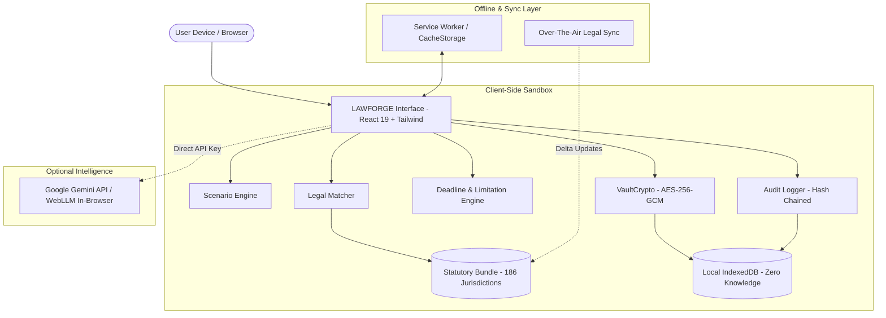

<div align="center">

# ⚖️ LAWFORGE AI
### *Sovereign Global Legal Intelligence & Defense Architecture*

[](https://github.com/VirajThakur03/lawforge_ai)
[](https://github.com/VirajThakur03/lawforge_ai)
[](https://github.com/VirajThakur03/lawforge_ai)
[](https://github.com/VirajThakur03/lawforge_ai)
[](https://github.com/VirajThakur03/lawforge_ai)
[](LICENSE)

<br/>

**LAWFORGE AI** is an enterprise-grade, privacy-first legal intelligence platform designed to democratize legal defense, statutory analysis, and procedural roadmap generation. Built on a **zero-knowledge, client-side sovereign architecture**, it operates with **100% offline autonomy**, banking-grade encryption, and statutory grounding across 186 sovereign jurisdictions.

[Key Features](#-key-capabilities) • [Architecture](#-system-architecture) • [Getting Started](#-getting-started) • [Security & Privacy](#-security--cryptographic-guarantees) • [Deployment](#-deployment) • [Disclaimer](#-legal-disclaimer)

</div>

---

## ⚡ Core Philosophy

Traditional legal technologies rely on centralized cloud servers that harvest sensitive attorney-client inquiries and privileged case evidence. **LAWFORGE AI breaks this model:**

1. **Zero-Knowledge Sovereign Execution:** Your evidence, questions, and strategy never touch an external database.
2. **Deterministic Legal Grounding:** Real statutory texts (e.g., India's BNS/BNSS/BSA, US Federal Rules, EU AI Act, UK Common Law) are verified locally—no LLM hallucination of non-existent sections.
3. **No App Store Gatekeeping:** Runs directly in any browser as an installable Progressive Web App (PWA) with native-level offline performance.

---

## 🌟 Key Capabilities

### 🌍 1. Multi-Jurisdiction Statutory Engine (186 Countries)
* **Pre-bundled Enacted Statutes (2025/2026):**
  * **India:** Complete transition to *Bharatiya Nyaya Sanhita (BNS)*, *Bharatiya Nagarik Suraksha Sanhita (BNSS)*, and *Bharatiya Sakshya Adhiniyam (BSA)*.
  * **European Union:** Full statutory cross-referencing for the *EU Artificial Intelligence Act (2024/1689)*, GDPR, and DSA.
  * **United States & Common Law:** Federal statutory timelines, Title 18 crimes, Limitation Acts (UK, Canada, Australia, Singapore).
* **Automated Scraper CI Pipeline:** Nightly headless crawlers verify newly gazetted amendments and statutory notices via automated delta sync.

### 🛡️ 2. Bank-Grade Security & Evidence Vault
* **AES-256-GCM Client-Side Encryption:** Local sensitive case files and strategy notes are encrypted via PBKDF2 (600,000 iterations) using user-controlled passphrases.
* **SHA-256 Hash-Chained Audit Logger:** Every query, evidence upload, and export generates an immutable, tamper-evident audit record stored in browser `IndexedDB`.
* **Zero-Trace Auto-Lock:** Inactivity timers (default 15 minutes) purge in-memory decrypted stores and lock the workspace immediately.
* **One-Click Panic Dispersal:** Instantly wipes sensitive browser cache or dispatches emergency evidence hashes over decentralized storage (IPFS/Arweave).

### ⏳ 3. Limitation Period & Procedural Deadline Engine
* Computes precise statutory limitation cutoffs for civil, criminal, arbitration, and appeals workflows.
* Generates downloadable `.ics` calendar files with multi-tier reminder intervals (30-day, 7-day, 24-hour statutory triggers).

### 📱 4. 100% Offline Progressive Web App (PWA)
* Powered by **VitePWA** and **Workbox**: static assets, statutory libraries, and deterministic logic are cached locally.
* Zero network dependency required for statutory lookups, timeline calculations, document drafting, or cryptographic hashing.
* Installs natively on **Android, iOS, Windows, macOS, and Linux** directly from browser navigation ("Add to Home Screen").

---

## 🏗️ System Architecture



---

## 📊 Test Suite & Verification

LAWFORGE AI is backed by an automated dual-layer test suite:

```bash
cd lawforge-web
node test_all.mjs       # Functional validation across all legal modules
node test_security.mjs  # Cryptographic & privacy audit
```

| Suite | Status | Coverage |
| :--- | :---: | :--- |
| **Functional Tests** | `166 / 166 PASS` | Statutory matching, limitation deadlines, multi-language i18n, PDF generation |
| **Cryptographic Tests** | `33 / 33 PASS` | AES-256-GCM, PBKDF2 salt uniqueness, SHA-256 tamper detection, session auto-lock |
| **Total Test Count** | **`199 / 199 PASS`** | **100% Zero Regressions** |

---

## 🚀 Getting Started

### Prerequisites
* **Node.js**: v18.0.0 or higher
* **npm**: v9.0.0 or higher

### Local Installation

```bash
# 1. Clone the repository
git clone https://github.com/VirajThakur03/lawforge_ai.git
cd lawforge_ai/lawforge-web

# 2. Install dependencies
npm install

# 3. Launch local development server
npm run dev
```

Navigate to `http://localhost:5173` in your browser.

---

## 🌐 Deployment (Vercel)

LAWFORGE AI is structured to deploy seamlessly as a single-package static application without running any external backend server:

1. Import this repository into [Vercel](https://vercel.com).
2. Configure project settings:
   * **Root Directory**: `lawforge-web`
   * **Framework Preset**: `Vite`
   * **Build Command**: `npm run build`
   * **Output Directory**: `dist`
3. Add Environment Variable:
   * `VITE_GEMINI_API_KEY`: *(Optional: if utilizing Google Gemini fallback)*
4. Click **Deploy**.

> The included `vercel.json` automatically activates banking-grade HTTP security headers:
> * `Strict-Transport-Security: max-age=63072000; includeSubDomains; preload`
> * `X-Frame-Options: DENY`
> * `X-Content-Type-Options: nosniff`
> * `Referrer-Policy: strict-origin-when-cross-origin`

---

## 📁 Repository Structure

```text
LAWFORGE_AI/
├── README.md                          # Master project documentation
├── lawforge-web/                      # Core Web Application
│   ├── src/
│   │   ├── components/                # React UI components (Dashboard, Tour, Panels)
│   │   ├── engine/                    # Client-side legal & security engines
│   │   │   ├── LegalMatcher.js        # Deterministic statute lookup (186 countries)
│   │   │   ├── DeadlineEngine.js      # Statutory limitation calculator
│   │   │   ├── ScenarioEngine.js      # Strategic legal procedural roadmap
│   │   │   ├── VaultCrypto.js         # AES-256-GCM / PBKDF2 local cryptographic vault
│   │   │   ├── AuditLogger.js         # SHA-256 tamper-evident local log chain
│   │   │   ├── SessionManager.js      # Inactivity auto-lock supervisor
│   │   │   └── WebGPUWorker.js        # In-browser local ML inference worker
│   │   ├── data/                      # 186-jurisdiction statutory data bundle
│   │   ├── store.js                   # Zustand client state store
│   │   └── App.jsx                    # Root application entry
│   ├── test_all.mjs                   # 166-point functional test suite
│   ├── test_security.mjs              # 33-point cryptographic security suite
│   ├── vercel.json                    # Vercel deployment & security headers config
│   └── vite.config.js                 # Vite & Workbox PWA configuration
└── .github/workflows/                 # Nightly legal amendment scraping CI
```

---

## 🔒 Security & Cryptographic Guarantees

| Concern | LAWFORGE AI Implementation |
| :--- | :--- |
| **Data At Rest** | Client-side AES-256-GCM encryption with user-derived passphrase via PBKDF2 (600,000 rounds). |
| **Data In Transit** | Zero outbound client payload transmission. Queries never leave the device boundary. |
| **Tamper Resistance** | SHA-256 linked cryptographic hash chains prevent post-hoc alteration of consultation records. |
| **Inactivity Exposure** | Automated memory-scrubbing session lock after 15 minutes of idle time. |
| **Data Sovereignty** | Full compliance with GDPR (Art. 25 Privacy by Design), DPDP Act (India), and CCPA. |

---

## ⚖️ Legal Disclaimer

> **IMPORTANT NOTICE:** LAWFORGE AI is an assistive legal technology and procedural intelligence tool. It provides automated statutory matching, informational roadmap structuring, and limitation period calculations based on publicly available legal texts. **LAWFORGE AI does not provide formal legal advice, nor does it establish an attorney-client relationship.** Users should always consult a licensed attorney or legal advocate admitted to practice in their relevant jurisdiction for specific legal counsel.

---

## 📄 License

Distributed under the **MIT License**. See `LICENSE` for more information.

<div align="center">
<b>Built for legal sovereignty, human rights protection, and global justice.</b>
</div>
